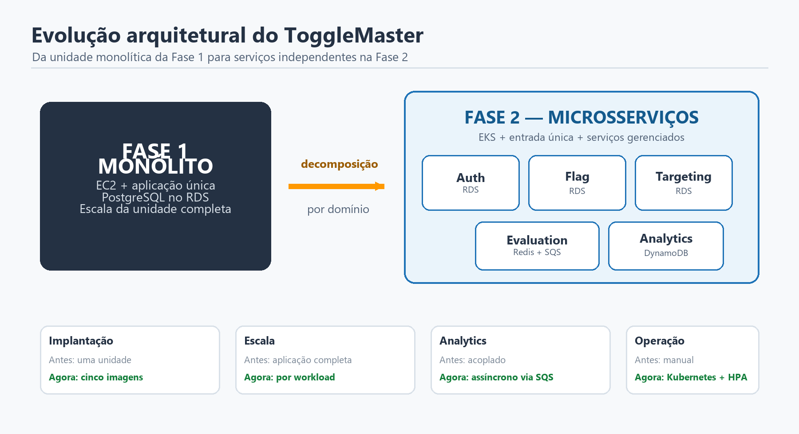
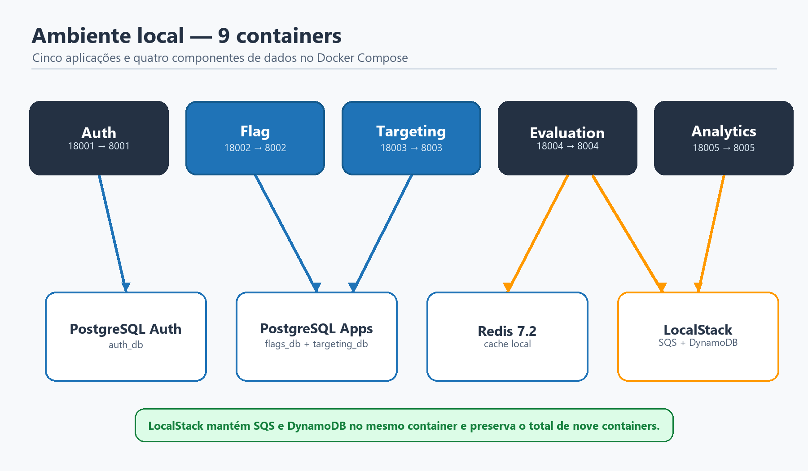
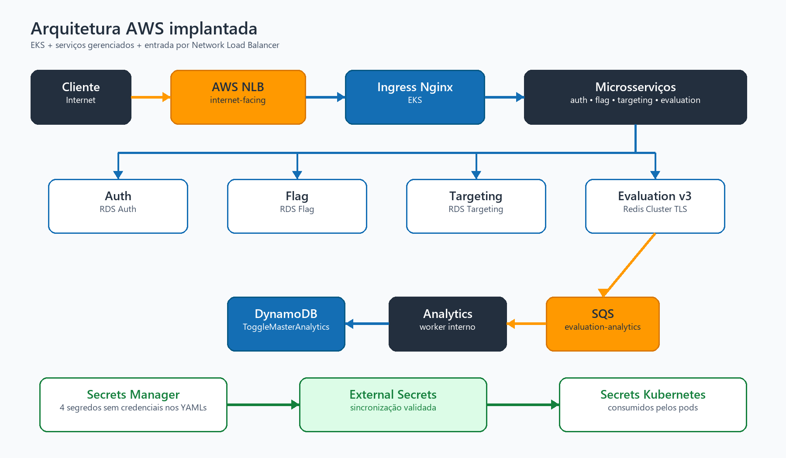
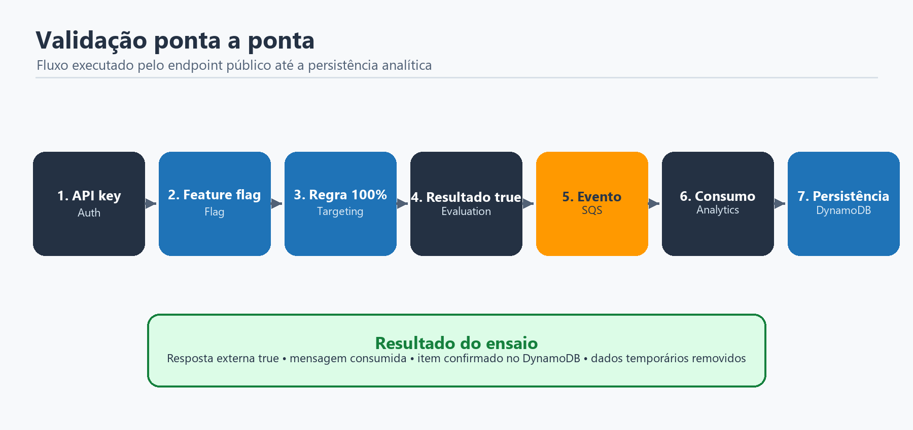

# TECH CHALLENGE — FASE 2 | TOGGLEMASTER

**Evolução da aplicação monolítica para uma plataforma de microsserviços no Kubernetes e na AWS**

**Curso:** Pós-Tech — DevOps | FIAP  
**Ambiente:** execução local, Kubernetes local e AWS Academy  
**Região AWS:** us-east-1 (N. Virginia)  
**Data de validação:** 29/10/2026

## Identificação da equipe

| Integrante | RM | Discord |
|---|---|---|
| Afonso Victoriano Franco | Preencher antes da entrega | Preencher antes da entrega |
| Cesar Augusto Ferreira Alves | Preencher antes da entrega | Preencher antes da entrega |
| Jeferson Lima Papalino | Preencher antes da entrega | Preencher antes da entrega |
| Jonatas Ariel Nunes | Preencher antes da entrega | Preencher antes da entrega |
| Willian Felix Corrêa | Preencher antes da entrega | Preencher antes da entrega |

> Os números de RM, usernames do Discord, endereço do repositório e link do vídeo não estavam presentes nos arquivos analisados. Esses campos permanecem destacados para preenchimento antes da entrega oficial.

## 1. Introdução

Na Fase 1, o ToggleMaster foi disponibilizado como uma aplicação monolítica executada em instâncias Amazon EC2 e conectada a um banco PostgreSQL no Amazon RDS. A solução foi adequada para validar o MVP, mas a evolução do volume de acessos e da complexidade funcional passou a exigir componentes independentes, escaláveis e com responsabilidades bem definidas.

Na Fase 2, o sistema foi decomposto em cinco microsserviços: autenticação, gerenciamento de feature flags, regras de segmentação, avaliação de flags e processamento analítico. Cada serviço foi conteinerizado, recebeu configuração própria e passou a ser implantado no Kubernetes. O ambiente de produção acadêmico utiliza Amazon EKS, imagens privadas no Amazon ECR e serviços gerenciados da AWS para persistência, cache e mensageria.

O trabalho contemplou três níveis complementares de execução:

- ambiente local completo com Docker Compose;
- cluster Kubernetes local com Kind para validação dos manifestos;
- implantação real no AWS Academy, com EKS e serviços gerenciados.

O resultado final foi validado ponta a ponta: uma requisição externa atravessou o Network Load Balancer e o Nginx Ingress, chegou aos microsserviços, consultou regras e flags, utilizou Redis, publicou um evento no SQS e terminou com a persistência do dado analítico no DynamoDB.

## 2. Objetivo

O objetivo desta fase foi transformar o MVP monolítico do ToggleMaster em um ecossistema distribuído e operável em Kubernetes, atendendo aos seguintes pontos:

- criar imagens Docker otimizadas para os cinco microsserviços;
- executar todo o ecossistema localmente em um único Docker Compose;
- provisionar e utilizar recursos gerenciados na AWS;
- publicar as imagens em cinco repositórios privados do ECR;
- implantar os serviços em um cluster EKS;
- utilizar Namespaces, Deployments, Services, ConfigMaps, Secrets, Ingress e probes;
- disponibilizar acesso externo através de Nginx Ingress e Network Load Balancer;
- implementar escalabilidade horizontal para evaluation e analytics;
- proteger configurações sensíveis com AWS Secrets Manager e External Secrets Operator;
- comprovar o fluxo funcional até a gravação no DynamoDB.

## 3. Evolução da arquitetura



**Figura 1 — Evolução arquitetural entre as Fases 1 e 2.**

Na arquitetura monolítica, uma única unidade de implantação concentrava autenticação, feature flags, regras, avaliação e persistência. Na nova arquitetura, cada domínio possui um serviço independente, com interface e dependências próprias.

Essa separação permite que o caminho de avaliação, mais sensível à latência, escale sem exigir réplicas adicionais de todas as demais funcionalidades. Também possibilita que o processamento analítico aconteça de forma assíncrona, sem aumentar o tempo de resposta percebido pelo cliente.

### 3.1 Microsserviços

| Serviço | Tecnologia | Porta | Responsabilidade | Dependência principal |
|---|---|---:|---|---|
| auth-service | Go, build 1.22 | 8001 | criação e validação de chaves de API | RDS PostgreSQL Auth |
| flag-service | Python 3.11 | 8002 | CRUD das definições de feature flags | RDS PostgreSQL Flag |
| targeting-service | Python 3.11 | 8003 | manutenção de regras de segmentação | RDS PostgreSQL Targeting |
| evaluation-service | Go, build 1.22 | 8004 | decisão final de avaliação, cache e publicação de eventos | ElastiCache Redis e SQS |
| analytics-service | Python 3.11 | 8005 | consumo assíncrono e persistência analítica | SQS e DynamoDB |

### 3.2 Fluxo funcional

O cliente cria ou utiliza uma chave no auth-service. As definições das flags ficam sob responsabilidade do flag-service e as regras são mantidas pelo targeting-service. Ao receber uma avaliação, o evaluation-service consulta os dois serviços, utiliza Redis para reduzir a latência do caminho quente e retorna o resultado booleano. Em seguida, publica um evento no SQS. O analytics-service consome esse evento e grava o registro na tabela DynamoDB.

## 4. Atendimento aos requisitos da Fase 2

| Requisito | Implementação | Situação |
|---|---|---|
| Cinco Dockerfiles | Um Dockerfile multi-stage por microsserviço | Atendido |
| Nove containers locais | Cinco aplicações, dois PostgreSQL, um Redis e um LocalStack | Atendido por equivalência funcional |
| DynamoDB local | DynamoDB emulado pelo LocalStack, junto com SQS | Atendido por equivalência funcional |
| Cluster Kubernetes | Kind no ambiente local e EKS no AWS Academy | Atendido |
| Cinco repositórios ECR | Um repositório privado por serviço | Atendido |
| Três bancos RDS | Auth, Flag e Targeting em instâncias independentes | Atendido |
| ElastiCache Redis | Redis Cluster com TLS para o evaluation-service | Atendido |
| DynamoDB | Tabela ToggleMasterAnalytics | Atendido |
| SQS Standard | Fila evaluation-analytics-queue | Atendido |
| Metrics Server | Instalado para fornecer métricas aos HPAs | Atendido |
| Nginx Ingress | ingress-nginx publicado por NLB | Atendido |
| Namespaces separados | auth, flag, targeting, evaluation e analytics | Atendido |
| Requests, limits e probes | Definidos nos cinco Deployments | Atendido |
| HPA do evaluation | CPU, mínimo 1 e máximo 5 réplicas | Atendido |
| HPA do analytics | CPU, mínimo 1 e máximo 5 réplicas | Atendido |
| Teste ponta a ponta | Validado até SQS, Analytics e DynamoDB | Atendido |

O enunciado menciona DynamoDB Local. Foi utilizado LocalStack porque ele reproduz tanto DynamoDB quanto SQS em um único container, mantendo o total exigido de nove containers e permitindo testar localmente o mesmo fluxo assíncrono usado na AWS.

## 5. Ambiente local com Docker Compose

O arquivo `docker-compose.yml` sobe todos os componentes necessários sem depender de uma conta AWS. Os serviços de aplicação continuam ouvindo internamente nas portas 8001 a 8005; no Windows, são publicadas as portas 18001 a 18005 para evitar conflito com outros projetos.



**Figura 2 — Ambiente local com cinco aplicações e quatro componentes de dados.**

### 5.1 Containers locais

| Container | Imagem ou build | Porta publicada | Finalidade |
|---|---|---:|---|
| auth-service | build local | 18001 | autenticação e chaves de API |
| flag-service | build local | 18002 | feature flags |
| targeting-service | build local | 18003 | regras de segmentação |
| evaluation-service | build local | 18004 | avaliação e publicação de eventos |
| analytics-service | build local | 18005 | worker e health endpoint |
| auth-db | postgres:16-alpine | interna | banco auth_db |
| apps-db | postgres:16-alpine | interna | bancos flags_db e targeting_db |
| redis | redis:7.2-alpine | interna | cache de avaliação |
| aws-local | localstack/localstack:3.8.1 | 4566 | SQS e DynamoDB locais |

Os health checks e as condições de dependência evitam que as aplicações iniciem antes dos bancos e dos serviços emulados. Os volumes nomeados preservam os dados entre reinicializações.

### 5.2 Execução local

```powershell
Copy-Item .env.example .env
.\scripts\start-local.ps1
.\scripts\test-local.ps1
docker compose ps
```

O teste automatizado cria uma chave de API, registra uma flag, cria uma regra com 100% de ativação, avalia a flag, aguarda o processamento da fila e confirma a persistência no DynamoDB local.

### 5.3 Kubernetes local

O projeto também inclui um cluster Kind isolado, com Nginx Ingress e Metrics Server. O Ingress local é publicado em `http://localhost:18080`, usando o cabeçalho `Host: togglemaster.local`.

```powershell
.\scripts\setup-kind.ps1
.\scripts\test-k8s.ps1
kubectl get pods -n togglemaster
kubectl get hpa -n togglemaster
```

O Kind não substitui as evidências da AWS, mas reduz o risco de falhas de manifesto antes da aplicação no EKS.

No ambiente Kubernetes local, o HPA do evaluation trabalha entre 2 e 8 réplicas e o do analytics entre 1 e 6, ambos com alvo de CPU de 70%. Esses parâmetros são diferentes do ambiente AWS, onde a faixa é de 1 a 5 réplicas e o alvo foi reduzido para 30% para facilitar a demonstração acadêmica.

## 6. Conteinerização

Os cinco Dockerfiles utilizam múltiplos estágios. O estágio de build contém compiladores e dependências; o estágio final recebe somente o necessário para execução.

| Serviço | Imagem de build | Imagem final | Processo de execução |
|---|---|---|---|
| auth-service | golang:1.22-alpine | alpine:3.20 | binário Go estático |
| flag-service | python:3.11-slim | python:3.11-slim | Gunicorn, 2 workers e 2 threads |
| targeting-service | python:3.11-slim | python:3.11-slim | Gunicorn, 2 workers e 2 threads |
| evaluation-service | golang:1.22-alpine | alpine:3.20 | binário Go estático |
| analytics-service | python:3.11-slim | python:3.11-slim | Gunicorn, 1 worker e 2 threads |

Boas práticas aplicadas:

- execução como usuário não privilegiado de UID 10001;
- dependências instaladas em estágio separado;
- imagens finais menores, sem compiladores;
- health checks em todos os containers;
- logs direcionados para saída padrão;
- binários Go compilados sem CGO, com símbolos removidos;
- ausência de credenciais reais nas imagens.

## 7. Arquitetura AWS implantada



**Figura 3 — Arquitetura validada no AWS Academy em 29/10/2026.**

O ambiente foi implantado na conta acadêmica, região `us-east-1`. A entrada pública é fornecida por um Network Load Balancer internet-facing. O tráfego segue para o Nginx Ingress Controller e é encaminhado ao Service Kubernetes correto conforme a rota.

### 7.1 Inventário principal

| Camada | Recurso implantado |
|---|---|
| Orquestração | EKS `eks-togglemaster`, Kubernetes 1.37 |
| Nós | 2 nós em estado Ready |
| Registro de imagens | cinco repositórios privados no ECR |
| Entrada | NLB + ingress-nginx chart 4.15.1 / app 1.15.1 |
| Bancos relacionais | três instâncias privadas RDS PostgreSQL |
| Cache | ElastiCache Redis Cluster com TLS |
| Mensageria | SQS Standard `evaluation-analytics-queue` |
| NoSQL | DynamoDB `ToggleMasterAnalytics` |
| Segredos | AWS Secrets Manager + External Secrets Operator 2.14.0 |
| Escala | Metrics Server + dois HPAs |

### 7.2 Imagens publicadas

| Serviço | Versão implantada |
|---|---|
| auth-service | v1 |
| flag-service | v1 |
| targeting-service | v1 |
| evaluation-service | v3 |
| analytics-service | v1 |

A versão `v3` do evaluation-service contém a correção de compatibilidade com o Redis 7 do ElastiCache. O digest registrado no ECR foi `sha256:8e6fdb41e384e0f929a39d1cc5ac5234f76d6997fd249ec05092c70bbf6d6c0d`.

### 7.3 Endpoint externo

```text
http://ae6a5981f8069438481a714114fef81d-9676d8a498457cbb.elb.us-east-1.amazonaws.com
```

Esse DNS é gerado pela AWS e pode mudar se o Service do ingress-nginx for recriado. A raiz `/` não possui rota e, portanto, retorna `404 Not Found` do Nginx. Esse retorno não indica falha do Load Balancer; as rotas válidas são as definidas nos Ingresses.

## 8. Kubernetes no EKS

Cada domínio possui seu próprio Namespace. Essa separação simplifica a organização, limita colisões de nomes e prepara o ambiente para políticas mais específicas.

| Namespace | Deployment | Service | Porta |
|---|---|---|---:|
| auth | auth-service | ClusterIP | 8001 |
| flag | flag-service | ClusterIP | 8002 |
| targeting | targeting-service | ClusterIP | 8003 |
| evaluation | evaluation-service | ClusterIP | 8004 |
| analytics | analytics-service | ClusterIP | 8005 |

### 8.1 Recursos e probes

| Serviço | CPU request/limit | Memória request/limit | Probes |
|---|---|---|---|
| auth | 100m / 500m | 128Mi / 256Mi | startup, readiness e liveness HTTP |
| flag | 100m / 500m | 128Mi / 384Mi | startup, readiness e liveness HTTP |
| targeting | 100m / 500m | 128Mi / 384Mi | startup, readiness e liveness HTTP |
| evaluation | 100m / 500m | 128Mi / 256Mi | startup, readiness e liveness HTTP |
| analytics | 100m / 500m | 128Mi / 384Mi | startup TCP, readiness HTTP e liveness TCP |

Os requests permitem ao scheduler reservar capacidade, enquanto os limits reduzem o risco de um pod consumir recursos excessivos. As probes impedem o envio de tráfego antes de a aplicação estar pronta e permitem recuperação automática de processos sem resposta.

### 8.2 Roteamento do Ingress

| Operação | Método e rota pública | Destino interno |
|---|---|---|
| Saúde do Auth | GET `/auth/health` | auth-service:8001 `/health` |
| Criar API key | POST `/auth/admin/keys` | auth-service:8001 `/admin/keys` |
| Validar API key | GET `/auth/validate` | auth-service:8001 `/validate` |
| Feature flags | GET/POST `/flags` | flag-service:8002 |
| Flag específica | GET/PUT/DELETE `/flags/{name}` | flag-service:8002 |
| Regras | POST `/rules` | targeting-service:8003 |
| Regra específica | GET/PUT/DELETE `/rules/{flag_name}` | targeting-service:8003 |
| Avaliação | GET `/evaluate?user_id={id}&flag_name={flag}` | evaluation-service:8004 |

O analytics-service é um worker interno e não possui Ingress público.

### 8.3 Inicialização dos bancos

Três Jobs Kubernetes executam os scripts SQL de inicialização:

- `auth-db-init`;
- `flag-db-init`;
- `targeting-db-init`.

Durante a validação, os três Jobs atingiram o estado `Succeeded`. Como possuem limpeza automática após a conclusão, eles podem não permanecer listados indefinidamente. Os scripts ficam em ConfigMaps e as URLs de conexão são obtidas dos Secrets sincronizados.

## 9. Serviços de dados e mensageria

Os recursos foram escolhidos de acordo com o perfil de cada dado, evitando utilizar um único banco para todas as necessidades.

| Serviço AWS | Tipo de dado | Motivo da escolha |
|---|---|---|
| RDS PostgreSQL | chaves, flags e regras | consistência transacional, relacionamentos e consultas estruturadas |
| ElastiCache Redis | resultados temporários de avaliação | baixa latência e acesso rápido no caminho quente |
| DynamoDB | eventos analíticos | alta escala, persistência NoSQL e acesso por chave |
| SQS | eventos de avaliação | desacoplamento, absorção de picos e processamento assíncrono |

### 9.1 RDS PostgreSQL

Auth, Flag e Targeting utilizam instâncias independentes. Essa abordagem evita que um serviço acesse diretamente as tabelas de outro e preserva a autonomia dos domínios. As instâncias não são publicamente acessíveis; a porta 5432 é liberada somente para a origem autorizada do EKS.

### 9.2 ElastiCache Redis

O evaluation-service utiliza Redis Cluster com criptografia em trânsito. A conexão usa TLS e autenticação, armazenadas fora dos manifestos. O cache reduz chamadas repetidas aos serviços de flag e targeting durante a janela configurada.

### 9.3 SQS e DynamoDB

Depois de responder ao cliente, o evaluation-service publica um evento na fila. O analytics-service realiza long polling, grava o item no DynamoDB e somente então remove a mensagem da fila. Assim, a persistência analítica não bloqueia o caminho síncrono da avaliação.

O SQS Standard oferece entrega pelo menos uma vez. O ensaio confirmou o fluxo ponta a ponta, mas a implementação ainda não apresenta DLQ, idempotência baseada no identificador da mensagem ou padrão outbox. Se a gravação ocorrer e a remoção da mensagem falhar, uma nova tentativa pode gerar duplicidade. Além disso, a publicação pelo evaluation ocorre de forma assíncrona e ainda não possui retry persistente. Essas garantias adicionais ficam como evolução para produção.

## 10. Segurança

A implantação evita armazenar credenciais temporárias ou senhas diretamente nos YAMLs.

### 10.1 Gestão de segredos

```text
AWS Secrets Manager
        ↓
ClusterSecretStore
        ↓
External Secrets Operator
        ↓
Secrets Kubernetes
        ↓
Pods autorizados
```

Foram utilizados quatro documentos no Secrets Manager: `togglemaster/auth`, `togglemaster/flag`, `togglemaster/targeting` e `togglemaster/evaluation`. As três URLs de banco, a chave administrativa, o token Redis e a chave interna do evaluation permanecem no serviço gerenciado.

Os quatro recursos ExternalSecret foram validados com `SecretSynced=True`, e o ClusterSecretStore apresentou estado válido.

O intervalo de sincronização é de um minuto. Como os serviços consomem esses valores por variáveis de ambiente, uma rotação atualiza o Secret Kubernetes, mas os pods em execução precisam de rollout controlado ou de um reloader para receber o novo valor.

### 10.2 Segurança dos containers

Nos Deployments foram aplicados:

- `runAsNonRoot: true`;
- usuário e grupo 10001;
- `allowPrivilegeEscalation: false`;
- filesystem raiz somente leitura;
- remoção de todas as Linux capabilities;
- perfil seccomp `RuntimeDefault`;
- volumes temporários `emptyDir` somente quando necessários.

### 10.3 Rede e identidade

RDS e ElastiCache permanecem privados. Os Security Groups liberam somente EKS para RDS em TCP 5432 e EKS para Redis em TCP 6379. O NLB expõe o Ingress, não os bancos.

No AWS Academy, a LabRole existente foi utilizada porque o laboratório não permite criar roles específicas. O IMDSv2 foi mantido obrigatório e o hop limit foi configurado como 2 para permitir que os pods alcançassem as credenciais temporárias do nó. Essa é uma limitação do laboratório; em produção, a recomendação é usar EKS Pod Identity ou IRSA com políticas mínimas por serviço.

> **Limite do laboratório:** o endpoint observado utiliza HTTP. Chaves enviadas à API, inclusive a Master Key usada na rota administrativa, não devem trafegar dessa forma em produção. Também não há NetworkPolicy, WAF ou rate limiting comprovados. Namespaces organizam os recursos, mas não isolam o tráfego por si só. Uma publicação real exige HTTPS, restrição da rota administrativa, controles de borda e segmentação de rede.

## 11. Escalabilidade e resiliência

O Metrics Server fornece utilização de CPU aos HPAs. Foram criados dois recursos `autoscaling/v2`:

| HPA | Mínimo | Máximo | Métrica | Alvo | Estabilização de scale-down |
|---|---:|---:|---|---:|---:|
| evaluation-service-hpa | 1 | 5 | CPU média | 30% | 60 segundos |
| analytics-service-hpa | 1 | 5 | CPU média | 30% | 60 segundos |

O alvo de 30% foi adotado para tornar a demonstração de escalabilidade mais sensível no ambiente acadêmico. O evaluation escala para responder ao aumento de requisições. O analytics escala quando o consumo de mensagens aumenta sua utilização de CPU.

O KEDA seria mais apropriado para escalar o analytics diretamente pela profundidade da fila, inclusive de zero réplicas. Ele não foi usado porque a criação das roles necessárias não é permitida pela LabRole do AWS Academy. O HPA por CPU é o workaround previsto no enunciado.

Além da escala horizontal, a solução utiliza readiness e liveness probes, reinício automático dos containers, fila para amortecer picos e dois nós Ready no cluster.

Os dois targets saudáveis do NLB e os dois nós não significam alta disponibilidade completa das aplicações. A réplica inicial dos Deployments é 1, e não foram configurados PodDisruptionBudgets, anti-affinity ou topology spread. O HPA oferece capacidade de escala, mas a distribuição e a tolerância a interrupções ainda podem evoluir.

## 12. Configuração e sequência de implantação

A implantação foi executada em uma ordem que reduz dependências circulares e facilita o diagnóstico.

1. Validar conta, região, recursos gerenciados e repositórios ECR.
2. Publicar as cinco imagens nos respectivos repositórios.
3. Validar o EKS e recuperar os dois nós.
4. Ajustar o hop limit do IMDS para 2, mantendo IMDSv2 obrigatório.
5. Liberar os fluxos de rede EKS para RDS e ElastiCache.
6. Instalar Metrics Server, ingress-nginx e External Secrets Operator.
7. Criar o ClusterSecretStore e sincronizar os quatro segredos.
8. Executar os três Jobs de inicialização SQL.
9. Aplicar Deployments, Services, ConfigMaps, Ingresses e HPAs.
10. Validar pods, probes, endpoints e logs.
11. Publicar a correção do evaluation-service como v3 e executar o rollout.
12. Provisionar o NLB através do Service do ingress-nginx.
13. Executar o smoke test externo completo.

Comandos operacionais principais:

```powershell
kubectl kustomize .\k8s-aws
kubectl apply -k .\k8s-aws
kubectl get pods,svc,ingress,hpa -A
kubectl get externalsecret -A
kubectl get clustersecretstore
```

## 13. Correção do evaluation-service

Durante o rollout inicial, o evaluation-service encerrava ao interpretar a resposta `CLUSTER SLOTS` do Redis 7 do ElastiCache. A biblioteca `github.com/go-redis/redis/v8 v8.11.5` aceitava somente duas ou três posições no endereço do nó, mas o serviço gerenciado retornava quatro.

Erro observado:

```text
got 4 elements in cluster info address, expected 2 or 3
```

A solução aplicada foi:

- migrar para `github.com/redis/go-redis/v9 v9.18.0`;
- preservar TLS 1.2, autenticação e cluster mode;
- atualizar os testes do serviço;
- executar os testes com Go 1.22;
- gerar e publicar a imagem `evaluation-service:v3`;
- atualizar manifesto EKS, Compose AWS e documentação;
- executar novo rollout no cluster.

Após a correção, os logs confirmaram conexão com o Redis Cluster e inicialização do cliente SQS. Esse incidente demonstrou a importância de validar bibliotecas contra a resposta real do serviço gerenciado, não apenas contra o Redis local standalone.

## 14. Validação da aplicação



**Figura 4 — Sequência comprovada no smoke test externo.**

O teste realizado pelo endpoint do NLB executou as seguintes etapas:

1. criação de uma API key com a chave administrativa;
2. validação da nova API key no auth-service;
3. criação de uma feature flag habilitada;
4. criação de uma regra do tipo `PERCENTAGE` com valor 100;
5. chamada externa ao endpoint `/evaluate`;
6. retorno booleano `true`;
7. publicação do evento no SQS;
8. consumo da mensagem pelo analytics-service;
9. gravação na tabela `ToggleMasterAnalytics`;
10. remoção da flag e da regra temporárias.

Resposta funcional observada:

```json
{
  "flag_name": "<flag-de-teste>",
  "user_id": "<usuario-de-teste>",
  "result": true
}
```

### 14.1 Teste seguro pelo endpoint público

```powershell
$base = 'http://ae6a5981f8069438481a714114fef81d-9676d8a498457cbb.elb.us-east-1.amazonaws.com'
Invoke-RestMethod "$base/auth/health"
Invoke-RestMethod "$base/auth/validate" -Headers @{ Authorization = 'Bearer <API_KEY>' }
Invoke-RestMethod "$base/evaluate?user_id=usuario&flag_name=nome-da-flag"
```

As chaves devem ser informadas em tempo de execução e nunca incluídas em scripts versionados ou documentos.

## 15. Evidências do estado final

| Item verificado | Evidência registrada | Resultado |
|---|---|---|
| EKS | cluster `eks-togglemaster`, Kubernetes 1.37 | Aprovado |
| Nós | dois nós em estado Ready | Aprovado |
| Aplicações | cinco Deployments disponíveis em 1/1 no snapshot de 29/10/2026 | Aprovado |
| Estabilidade | pods em Running e zero reinicializações no snapshot de 29/10/2026 | Aprovado |
| Inicialização SQL | três Jobs concluídos durante a validação | Aprovado |
| Segredos | quatro ExternalSecrets sincronizados durante a validação | Aprovado |
| Secret store | ClusterSecretStore válido | Aprovado |
| NLB | internet-facing e estado active | Aprovado |
| Targets | dois targets saudáveis nas portas 80 e 443 | Aprovado |
| Escalabilidade | HPAs de evaluation e analytics ativos | Aprovado |
| Avaliação | resposta externa com resultado true | Aprovado |
| Mensageria | evento publicado e consumido no SQS | Aprovado |
| Analytics | item persistido no DynamoDB | Aprovado |

## 16. Arquitetura de microsserviços

### 16.1 Vantagens

- escalabilidade independente do caminho de avaliação e do worker analítico;
- isolamento de falhas e responsabilidades;
- deploy separado por serviço;
- possibilidade de escolher a tecnologia adequada a cada domínio;
- bancos e recursos de dados alinhados ao tipo de carga;
- processamento assíncrono para reduzir o acoplamento temporal;
- evolução gradual de cada componente.

### 16.2 Desvantagens e novos custos operacionais

- mais componentes para implantar, observar e proteger;
- necessidade de descoberta de serviços e roteamento;
- maior complexidade de diagnóstico entre chamadas distribuídas;
- consistência eventual no processamento analítico;
- gestão de versões de imagens e contratos de API;
- custo de cluster, Load Balancer e serviços gerenciados;
- necessidade futura de tracing, métricas e logs centralizados.

## 17. Análise dos 12-Factor App

| Fator | Situação na Fase 2 | Análise |
|---|---|---|
| I. Codebase | Atende | código organizado por serviço e manifestos versionáveis |
| II. Dependencies | Atende | Go Modules e requirements.txt; builds reproduzíveis em containers |
| III. Config | Atende | ConfigMaps e Secrets externos ao código |
| IV. Backing Services | Atende | RDS, Redis, SQS e DynamoDB tratados como recursos substituíveis |
| V. Build, Release, Run | Atende parcialmente | estágios separados, porém ainda sem pipeline CI/CD completo |
| VI. Processes | Atende | aplicações stateless; estado mantido em serviços externos |
| VII. Port Binding | Atende | cada serviço publica sua própria porta HTTP |
| VIII. Concurrency | Atende | Deployments e HPAs permitem múltiplas réplicas |
| IX. Disposability | Atende parcialmente | probes e reinício automático; graceful shutdown pode evoluir |
| X. Dev/Prod Parity | Atende parcialmente | mesmas APIs, porém LocalStack e bancos locais substituem serviços AWS |
| XI. Logs | Atende parcialmente | logs em stdout; falta centralização e correlação |
| XII. Admin Processes | Atende | inicialização de banco executada por Jobs Kubernetes |

Em comparação com a Fase 1, houve avanço expressivo em configuração externa, concorrência, processos stateless, separação de backing services e automação operacional.

## 18. Considerações de custos

O ambiente foi executado no AWS Academy e não foi registrada uma estimativa financeira consolidada para a Fase 2. Por isso, este documento não apresenta valores simulados como se fossem cobrança real.

Os principais direcionadores de custo em uma conta de produção seriam:

- plano de controle do EKS;
- instâncias do Managed Node Group;
- três instâncias RDS e armazenamento;
- ElastiCache Redis Cluster;
- Network Load Balancer e processamento de dados;
- armazenamento e transferência do ECR;
- requisições e armazenamento de SQS e DynamoDB;
- observabilidade no CloudWatch;
- tráfego entre zonas e eventual NAT Gateway.

Uma estimativa formal deve registrar região, tipos de instância, armazenamento, alta disponibilidade, volume de requisições e tráfego. Esses valores devem ser calculados no AWS Pricing Calculator próximo da data da entrega.

## 19. Desafios encontrados

- adaptação do projeto às limitações de IAM do AWS Academy;
- acesso dos pods aos serviços AWS usando a LabRole do nó;
- ajuste seguro do IMDSv2 e hop limit;
- comunicação privada entre EKS, três RDS e ElastiCache;
- sincronização de segredos sem credenciais estáticas nos YAMLs;
- inicialização independente dos três bancos;
- compatibilidade entre a biblioteca Redis e o Redis 7 em cluster mode;
- migração do Load Balancer clássico para NLB;
- validação de todos os caminhos do Ingress;
- confirmação do fluxo assíncrono até o DynamoDB;
- manutenção de equivalência funcional entre o ambiente local e a AWS.

## 20. Decisões técnicas

**Microsserviços por domínio:** autenticação, flags, targeting, avaliação e analytics foram separados para reduzir acoplamento e permitir escala independente.

**SQS entre avaliação e analytics:** o caminho síncrono retorna rapidamente e o processamento analítico ocorre de forma assíncrona.

**Redis no caminho quente:** avaliações repetidas podem ser atendidas com menor latência.

**Três RDS independentes:** cada serviço relacional controla seu próprio esquema e credenciais.

**LocalStack no ambiente local:** SQS e DynamoDB são reproduzidos em um único container, preservando o total de nove containers.

**Kustomize para os manifestos AWS:** permite renderização e aplicação conjunta, mantendo os diretórios organizados por domínio.

**External Secrets Operator:** evita copiar valores sensíveis para os manifestos e automatiza a sincronização com o Secrets Manager.

**HPA por CPU:** solução compatível com as limitações do AWS Academy; KEDA foi mantido como evolução recomendada.

**NLB com ingress-nginx:** oferece um único ponto de entrada e roteamento por caminho para os serviços públicos.

## 21. Limitações e melhorias recomendadas

1. Publicar o endpoint em um domínio Route 53 e habilitar HTTPS com certificado ACM.
2. Substituir LabRole e acesso via IMDS por EKS Pod Identity ou IRSA.
3. Aplicar políticas IAM mínimas e específicas para evaluation e analytics.
4. Implantar observabilidade centralizada com métricas, logs, alertas e tracing distribuído.
5. Criar pipeline CI/CD para testes, build, scan, publicação no ECR e rollout.
6. Utilizar tags imutáveis ou digest nos Deployments de todos os serviços.
7. Criar PodDisruptionBudgets e políticas de afinidade para maior disponibilidade.
8. Avaliar NetworkPolicies entre os Namespaces.
9. Configurar HTTPS, rate limiting e proteção de borda.
10. Usar KEDA para o analytics em uma conta que permita as roles necessárias.
11. Realizar testes de carga documentados e registrar o comportamento dos HPAs.
12. Automatizar a infraestrutura com Terraform ou outra ferramenta de IaC.
13. Adicionar DLQ, idempotência, alarmes e retry/outbox ao fluxo SQS.
14. Automatizar o rollout após rotação de Secrets.
15. Revisar os pools de conexão e a exposição de detalhes de erro dos serviços Python.

## 22. Conclusão

A Fase 2 transformou o ToggleMaster de um MVP monolítico em uma plataforma de microsserviços conteinerizada e implantada em Kubernetes. A solução atende aos requisitos centrais do desafio e foi validada tanto localmente quanto em um ambiente EKS real.

O uso combinado de RDS, ElastiCache, SQS e DynamoDB alinhou cada tipo de dado ao serviço mais adequado. O Nginx Ingress e o NLB forneceram uma entrada única, enquanto Metrics Server e HPA permitiram escalabilidade horizontal. A gestão de segredos foi elevada para o AWS Secrets Manager, sincronizado pelo External Secrets Operator.

O teste ponta a ponta confirmou a integração entre todas as camadas: autenticação, configuração de flags, regras, avaliação, cache, fila e analytics. A correção realizada no cliente Redis também demonstrou capacidade de diagnóstico e adaptação a diferenças reais entre o ambiente local e um serviço gerenciado.

Como próximos passos, a arquitetura deve evoluir em identidade por workload, HTTPS, CI/CD e observabilidade. Mesmo com as restrições do AWS Academy, o ambiente entregue estabelece uma base coerente para operação, escala e melhoria contínua.

## 23. Links e arquivos da entrega

| Item | Informação |
|---|---|
| Repositório principal | Preencher antes da entrega |
| Vídeo de demonstração | Preencher antes da entrega |
| Diagrama de arquitetura | `docs/arquitetura_aws_togglemaster.png` |
| Manifestos AWS | `k8s-aws/` e `k8s-aws.zip` |
| Docker Compose local | `docker-compose.yml` |
| Docker Compose com AWS | `docker-compose.aws.yml` |
| Relatório operacional | `docs/Relatorio_Implantacao_AWS_ToggleMaster.docx` |
| Documento final da Fase 2 | `docs/Tech_Challenge_Fase_2_ToggleMaster.docx` e `.pdf` |

### Checklist antes do envio

- preencher RM e Discord de todos os integrantes;
- inserir o link definitivo do repositório;
- inserir o link público ou compartilhado do vídeo;
- conferir se o endpoint do NLB continua válido;
- remover ou mascarar qualquer credencial em capturas de tela;
- exportar novamente o PDF após qualquer alteração no Word;
- revisar o sumário e a numeração de páginas.

---

**Documento elaborado a partir dos arquivos do projeto, dos manifestos e do estado AWS validado em 29/10/2026. Nenhuma credencial temporária, senha, token ou API key foi incluída.**
